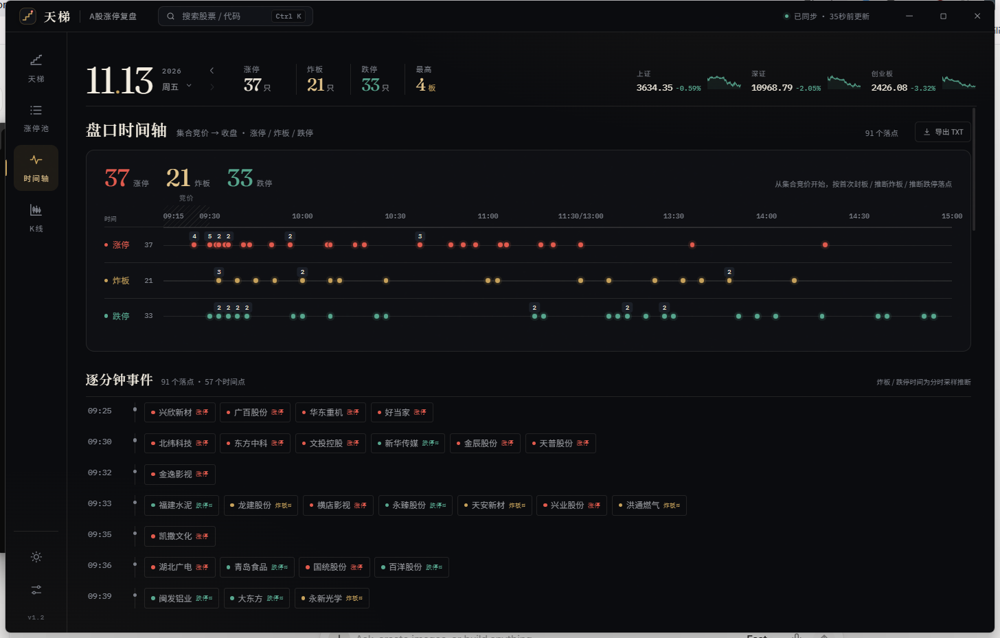
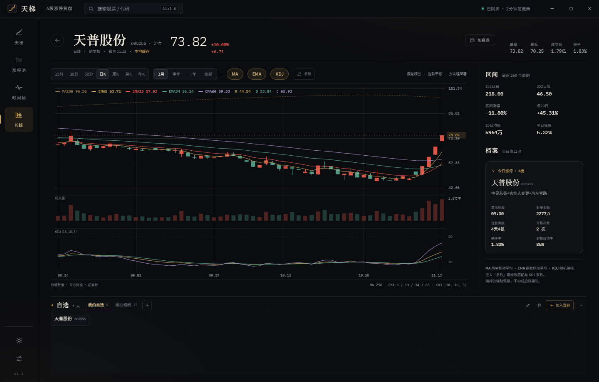
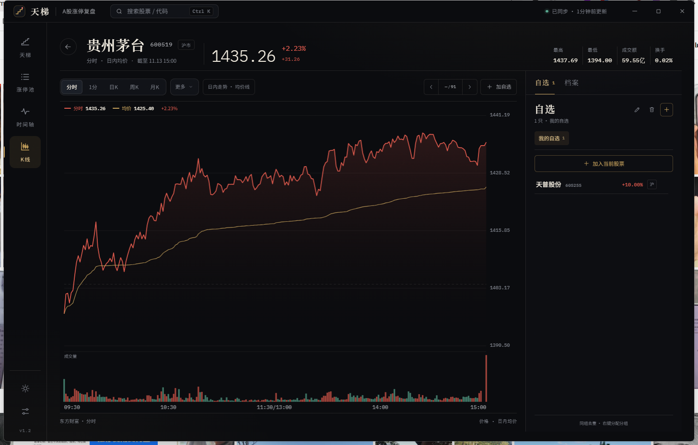

# 天梯 · A股涨停复盘

一个专注于「连板结构、盘口时间与K线复盘」的 Windows 桌面工具。


界面为深色「墨夜」与浅色「宣纸」两套主题；涨停、炸板、跌停数据来自同花顺公开接口，K线与指数来自东方财富公开接口。行情、K线、设置、自选分组与搜索历史全部写入 SQLite，不使用 JSON 数据文件。







## 功能

- **连板天梯**：按当前连续涨停高度分层，同一高度按首次封板时间从早到晚排列；最高标使用独立 feature 卡片，首板高密度收纳。顶部同时显示涨停 / 炸板 / 跌停 / 最高板；首板卡片悬停可查看首封时间、封单、换手与开板次数。
- **盘口池**：涨停、炸板、跌停三个池子切换；涨停池支持连板 / 首板 / 一字 / 换手筛选与板块筛选；炸板池展示开板次数、末封与推断炸板时间；跌停池展示推断跌停时间。切换池子与筛选只更新数据，不重绘整页。
- **盘口时间轴**：从 09:15 集合竞价到 15:00，一条压缩午休的时间线，分「涨停 / 炸板 / 跌停」三条泳道；点按落点可跳到逐分钟事件，并可导出为 `data/exports/盘口时间轴_YYYY-MM-DD.txt`。涨停时间取首次封板，炸板与跌停时间由分时采样推断。
- **K线与分时**：日 / 周 / 月 / 1分为常用周期，15/30/60分与年K收进「更多」下拉；新增「分时」模式，用 1 分钟数据画价格线、日内均价线、成交量与悬浮读数。MA、EMA、KDJ 可独立开关；MA / EMA 支持手动添加 / 删除线条（至少保留一条），每条线独立选择颜色、粗细、实线或虚线，也可用眼睛按钮单独隐藏。成交量、十字光标、滚轮缩放、拖动平移；标题栏可在当前池 / 自选分组中直接「上一只 / 下一只」。
- **自选与分组**：K线右侧常驻自选栏（与「档案」分页），竖向空间更大，也为后续同花顺自选接入预留分组结构；支持新建、重命名、二次确认删除分组；可把当前股票加入自选，也可把涨停池当前筛选结果批量加入；同组内自动去重，同一只股票可加入多个分组；右键股票可分配到其他分组或从当前分组移除。
- **指数**：顶部上证 / 深证 / 创业板显示日内分时走势；点击直接打开指数 K线。
- **搜索**：代码、名称、拼音首字母；最近查看保存在本地。
- **交易日历**：近一年交易日切换；数据本地缓存，离线仍可查看已拉取过的日期与 K线。
- **设置**：主题、界面字号（紧凑 102% / 舒适 110% / 大字号 118%，使用 WebView 系统缩放，K线同步重绘）、数据目录、数据库体积、行情缓存清理；清除行情缓存不会删除自选分组。
- **统一控件**：所有下拉框改为自绘浮层，不再依赖系统原生菜单；滚动条使用中性灰，不参与主题强调色；数字输入框去掉浏览器上下箭头。

## 便携版

- 可执行文件：`release/TianTi.exe`
- 首次启动后会在 exe 同级创建 `data/`：
  - `data/tianti.db`：SQLite 数据库（行情、K线、设置、自选、搜索历史）
  - `data/tianti.db-wal` / `data/tianti.db-shm`：SQLite 运行时文件
- 直接把 `TianTi.exe` 和 `data/` 一起拷贝到另一台 Windows 机器即可继续使用。
- 运行需要系统的 Microsoft Edge WebView2 Runtime（Windows 10/11 通常已内置）。

> 不使用 JSON 作为数据存储。接口响应只在内存中解析后写入 SQLite。

## 快捷键

| 快捷键 | 行为 |
| --- | --- |
| `Ctrl K` | 呼出搜索 |
| `←` `→` | 切换交易日 |
| `Esc` | 关闭浮层 / 右键菜单 |
| K线内 `←` `→` | 移动十字光标 |
| K线内 `+` `-` | 缩放 |
| 双击 K线 / 滚轮 | 重置 / 缩放 |

## 本地开发

需要 Rust 1.77+、Node.js 20+、pnpm。

```bash
pnpm install
pnpm dev            # 浏览器调试（带 dev mock 数据）
pnpm build
cargo build --release --manifest-path src-tauri/Cargo.toml --features custom-protocol
```

`custom-protocol` 是 Tauri 的正式构建特性：启用后 exe 内嵌前端资源，不再依赖 `localhost:1420`。未启用时按开发模式运行。

Tauri 应用的窗口资源由 `src-tauri/tauri.conf.json` 配置；数据目录固定为 exe 同级 `data/`。

## 数据来源

- 涨停池 / 炸板池 / 跌停池 / 连板高度 / 板块：同花顺公开数据接口
- K线 / 指数 / 搜索：东方财富公开数据接口

炸板、跌停池接口不含精确时间字段，时间轴与表格中的炸板 / 跌停时间根据 `time_preview` 分时采样推断，界面会以 `~` 标注。仅供学习与复盘，不构成投资建议。

## 从旧版保留与移除

保留并强化：涨停池、连板高度、板块主线、个股 K线。

新增：炸板池、跌停池、盘口时间轴与 TXT 导出、指数 K线与日内分时、1分钟 K线、分时走势、MA/EMA 线条增删与单线隐藏、统一自绘下拉框、字号比例、右侧分组自选、天梯同日排序与首板悬停详情。

移除：热点事件流、复盘报告导出、LLM 提示词、代理设置、同花顺 iframe 资料页、TradingView 外链与相应设置。产品聚焦在「看高度、看主线、看盘口、看K线」。
