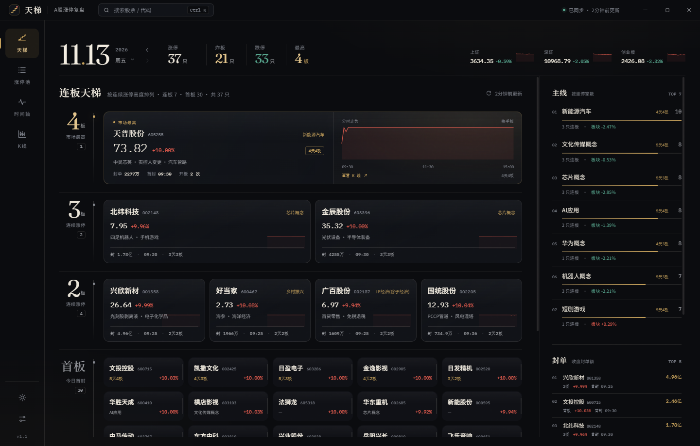
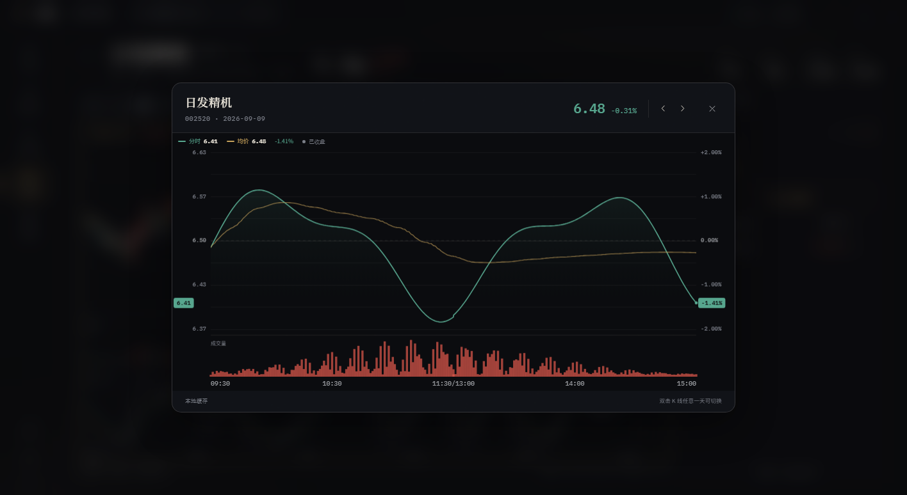
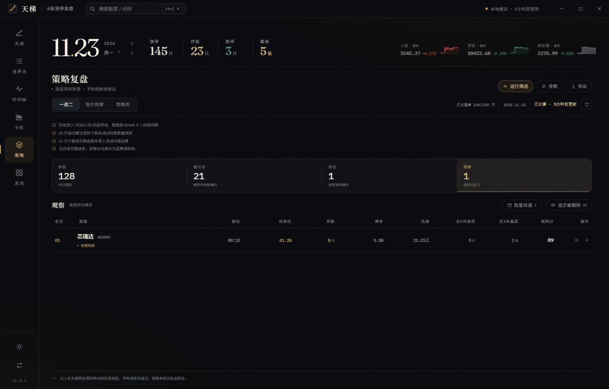
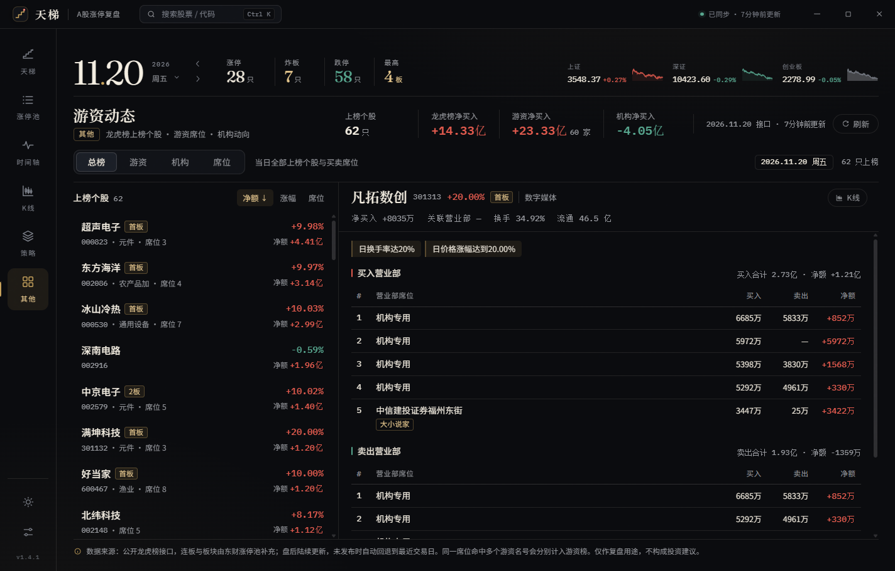
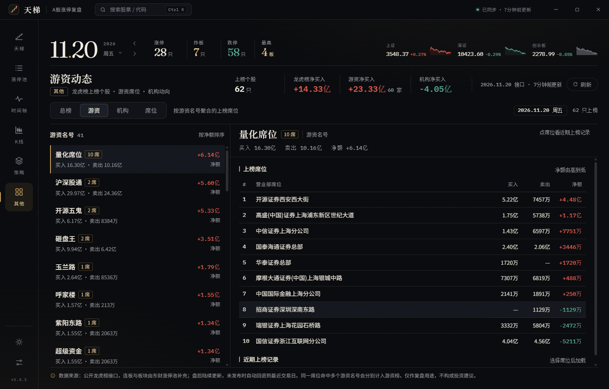
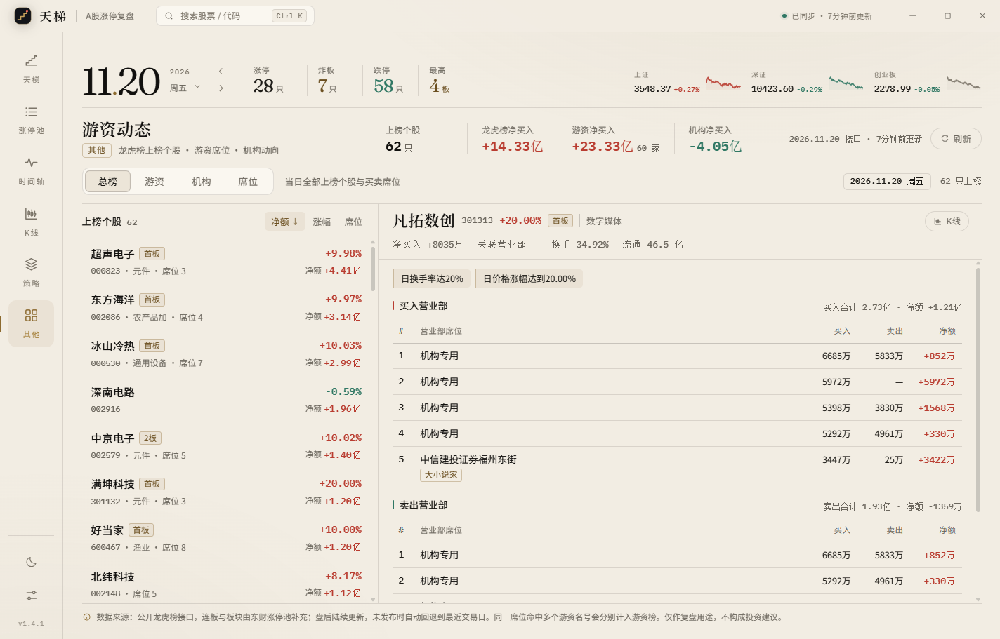

# 天梯 · A股涨停复盘

一个专注于「连板结构、盘口时间与K线复盘」的 Windows 桌面工具。



界面为深色「墨夜」与浅色「宣纸」两套主题；涨停、炸板、跌停数据来自同花顺公开接口，K线与指数来自东方财富公开接口。行情、K线、设置、自选分组与搜索历史全部写入 SQLite，不使用 JSON 数据文件。












## 功能

- **连板天梯**：按当前连续涨停高度分层，同一高度按首次封板时间从早到晚排列；最高标使用独立 feature 卡片，首板高密度收纳。顶部同时显示涨停 / 炸板 / 跌停 / 最高板；首板卡片悬停可查看首封时间、封单、换手与开板次数。天梯里的分时走势按真实交易时钟截断：盘中只画到当前时刻，15:00 不会提前“走完”；最新点带红点脉冲，收盘后自动变为静态点。
- **盘口池**：涨停、炸板、跌停三个池子切换；涨停池支持连板 / 首板 / 一字 / 换手筛选与板块筛选；炸板池展示开板次数、末封与推断炸板时间；跌停池展示推断跌停时间。切换池子与筛选只更新数据，不重绘整页。
- **盘口时间轴**：从 09:15 集合竞价到 15:00，一条压缩午休的时间线，分「涨停 / 炸板 / 跌停」三条泳道；点按落点可跳到逐分钟事件，并可导出为 `data/exports/盘口时间轴_YYYY-MM-DD.txt`。涨停时间取首次封板，炸板与跌停时间由分时采样推断；炸板票的首封、收盘涨停票的盘中开板用虚线空心点补在对应泳道（置灰），逐分钟事件中以灰色副行呈现，不重复计数，行内不写具体时点、首封与炸板时间放在 hover 提示里；逐分钟事件支持正序 / 倒序切换。
- **K线与分时**：日 / 周 / 月 / 1分为常用周期，15/30/60分与年K收进「更多」下拉；新增「分时」模式，用 1 分钟数据画价格线、日内均价线、成交量与悬浮读数；1分钟与分时的底部时间轴固定为开盘、上午收盘/下午开盘、收盘等关键时点，午休合并显示；分时可切换「全天」与「跟随」两种时间轴。分时采用双纵轴：左侧价格（指数为点数），右侧为相对昨收的百分比；指数不绘制没有意义的“均价线”，避免成交额/成交量把纵轴拉成一条横线。纵轴刻度支持自动 / 疏 / 密三档，也可以在左右坐标轴上滚动滚轮微调、双击图表复位；最新价带红点脉冲与左右价格标签。MA、EMA、KDJ 可独立开关；MA / EMA 支持手动添加 / 删除线条（至少保留一条），每条线独立选择颜色、粗细、实线或虚线，也可用眼睛按钮单独隐藏。成交量、十字光标、滚轮缩放、拖动平移；标题栏可在当前池 / 自选分组中直接「上一只 / 下一只」。1 分钟 K 线只认东方财富，取不到时展示本地缓存并提示，不用腾讯分时点位凑假 OHLC；分时只读收盘价，仍可回退腾讯。**双击日 / 周 / 月 K 线的任意一根**，会弹出当天的分时：东财 1 分钟优先，不可用时回退腾讯点位，弹层内可用左右箭头切换相邻交易日。
- **策略复盘**：第 5 个一级入口「策略」，分「一进二 / 竞价观察 / 策略库」三个页签。一进二对当日首板按固定规则筛选：先过硬过滤（首板、股价 ≤30 元、流通 ≤200 亿、近 120 个交易日涨停 ≥3 次、近 250 个交易日最高连板 <4 且 20 日最大涨幅 <60%、板块 ≥3 家涨停且有连板），再过质量检查（非一字板、首封不晚于 10:00、换手 ≥5%、开板 0 次、封单比 ≥10%），按规则分排序输出候选池；其余涨停列在「被剔除」里并逐条写明原因，数据不足显示待补而不算通过。**漏斗里的「首板 / 硬过滤 / 候选 / 观察」可以点**，下方直接列出该阶段个股：首板按首封时间、硬过滤按规则分，结果列写「观察 #n / 候选 / 待补」或卡住的规则。13 项参数可调并保存；观察 / 候选 / 首板 / 硬过滤四类列表都支持「批量自选」，一次把当前列表加入自选分组。候选可导出 TXT、单只加入自选、点行进 K 线。策略结果有缓存：同一日期 + 参数 + 历史覆盖只算一次（页签行显示「缓存 / 已计算 · 多久前」），过去日期的 K 线聚合落 `stock_stats_day`，切日期不重算、不重复拉 K 线；休市期间优先本地缓存：收盘后 15:05 补拉一次当天定稿快照，之后与周末/节假日不在后台联网刷新；休市启动时若指数/K 线缓存落后会各补一次，交易日历仍会刷新。历史侧回填近 250 个交易日的涨停池，今日成交额用腾讯批量报价补齐，09:25–09:30 的竞价只做实时采样。页面底部固定展示免责声明：以上仅为按固定规则筛出的复盘候选，不构成投资建议。
- **自选与分组**：K线右侧常驻自选栏（与「档案」分页），竖向空间更大，也为后续同花顺自选接入预留分组结构；支持新建、重命名、二次确认删除分组；可把当前股票加入自选，也可把涨停池当前筛选结果批量加入；同组内自动去重，同一只股票可加入多个分组；右键股票可分配到其他分组或从当前分组移除。
- **其他 · 游资动态**：第 6 个一级入口「其他」下的第一个模块。把龙虎榜搬进桌面端，分「总榜 / 游资 / 机构 / 席位」四个页签：总榜按净额 / 涨幅 / 席位排序，点开一只票即可看当日买入 / 卖出席位、上榜理由与近期上榜日期；游资按本地游资名号库聚合席位净额；机构看机构专用席位净买入；席位榜给出营业部净额排行，点席位读取近期上榜记录（最多 200 条，标注实际覆盖区间；同日同票的当日榜 / 三日榜只取当日榜，避免重复相加）。席位带游资名号、一线 / 顶级 / 知名等级、昨买昨卖与关联标记，连板与板块由东财涨停池补充。龙虎榜盘后才更新，当天没发布时自动回退到最近交易日并明确标注；数据只在内存缓存，不写数据库。
- **指数**：顶部上证 / 深证 / 创业板显示日内分时走势；点击直接打开指数 K线。
- **搜索**：代码、名称、拼音首字母；最近查看保存在本地。
- **交易日历**：近一年交易日切换；数据本地缓存，离线仍可查看已拉取过的日期与 K线。
- **设置**：主题、界面字号（紧凑 102% / 舒适 110% / 大字号 118%，使用 WebView 系统缩放，K线同步重绘）、数据目录、数据库体积、行情缓存清理；清除行情缓存不会删除自选分组。
- **线程与刷新**：盘中天梯池每分钟静默刷新一次，分时 1 分钟数据每 30 秒刷新一次；收盘后自动停止，最新点脉冲也随之静止。
- **统一控件**：所有下拉框改为自绘浮层，不再依赖系统原生菜单；滚动条使用中性灰，不参与主题强调色；数字输入框去掉浏览器上下箭头。
- **启动**：原生 GDI 启动板先于 WebView2 出现，展示品牌动画，主界面就绪后移除，避免冷启动黑屏；窗口背景色、任务栏图标与 AppUserModelID 同步设置，便携版在开始菜单里也能显示正确图标。

## 便携版

- 可执行文件：`release/TianTi.exe`
- 首次启动后会在 exe 同级创建 `data/`：
  - `data/tianti.db`：SQLite 数据库（行情、K线、设置、自选、搜索历史）
  - `data/tianti.db-wal` / `data/tianti.db-shm`：SQLite 运行时文件
- 直接把 `TianTi.exe` 和 `data/` 一起拷贝到另一台 Windows 机器即可继续使用。
- 运行需要系统的 Microsoft Edge WebView2 Runtime（Windows 10/11 通常已内置）。

> 不使用 JSON 作为数据存储。接口响应只在内存中解析后写入 SQLite。

## 快捷键

| 快捷键 | 行为 |
| --- | --- |
| `Ctrl K` | 呼出搜索 |
| `←` `→` | 切换交易日 |
| `Esc` | 关闭浮层 / 右键菜单 |
| K线内 `←` `→` | 移动十字光标 |
| K线内 `+` `-` | 缩放 |
| 双击 K线 / 滚轮 | 重置 / 缩放 |

## 本地开发

需要 Rust 1.77+、Node.js 20+、pnpm。

```bash
pnpm install
pnpm dev            # 浏览器调试（带 dev mock 数据）
pnpm build:exe      # 构建 release exe，输出到 release/TianTi.exe
```

`build:exe` 会先跑 TypeScript 检查和 Vite 构建，再用 `custom-protocol` 编译 Rust，最后把 exe 复制到 `release/TianTi.exe`；不会生成 zip 或校验文件。调试构建用 `pnpm build:exe:debug`。

`custom-protocol` 是 Tauri 的正式构建特性：启用后 exe 内嵌前端资源，不再依赖 `localhost:1420`。未启用时按开发模式运行。

Tauri 应用的窗口资源由 `src-tauri/tauri.conf.json` 配置；数据目录固定为 exe 同级 `data/`。

## 数据来源

- 涨停池 / 炸板池 / 跌停池 / 连板高度 / 板块：同花顺公开数据接口
- 指数 / 个股实时报价：腾讯行情为主，新浪备用，东方财富最后兜底
- K线 / 分时：东方财富为主，腾讯日线/分时备用
- 搜索：东方财富公开数据接口
- 策略历史：近 250 个交易日涨停池按日回填（同花顺）；当日成交额用腾讯批量报价补齐；竞价仅在 09:25–09:30 实时采样，没有历史

炸板、跌停池接口不含精确时间字段，时间轴与表格中的炸板 / 跌停时间根据 `time_preview` 分时采样推断，界面会以 `~` 标注。仅供学习与复盘，不构成投资建议。

## 实时推送

新浪行情 WebSocket 已实测可作为约 3 秒级的报价推送（指数、自选、分时最新点），但不是逐笔 / L2，也不是正式开放 API。当前版本默认仍使用 HTTP 轮询；接入方案、候选接口对比、重连与降级设计见 [docs/REALTIME_WS_PLAN.md](./docs/REALTIME_WS_PLAN.md)，仓库另附 `scripts/probe-sina-ws.ps1` 只读探针。

## 从旧版保留与移除

保留并强化：涨停池、连板高度、板块主线、个股 K线。

新增：炸板池、跌停池、盘口时间轴与 TXT 导出、指数 K线与日内分时、1分钟 K线、分时走势、MA/EMA 线条增删与单线隐藏、统一自绘下拉框、字号比例、右侧分组自选、天梯同日排序与首板悬停详情。

移除：热点事件流、复盘报告导出、LLM 提示词、代理设置、同花顺 iframe 资料页、TradingView 外链与相应设置。产品聚焦在「看高度、看主线、看盘口、看K线」。
